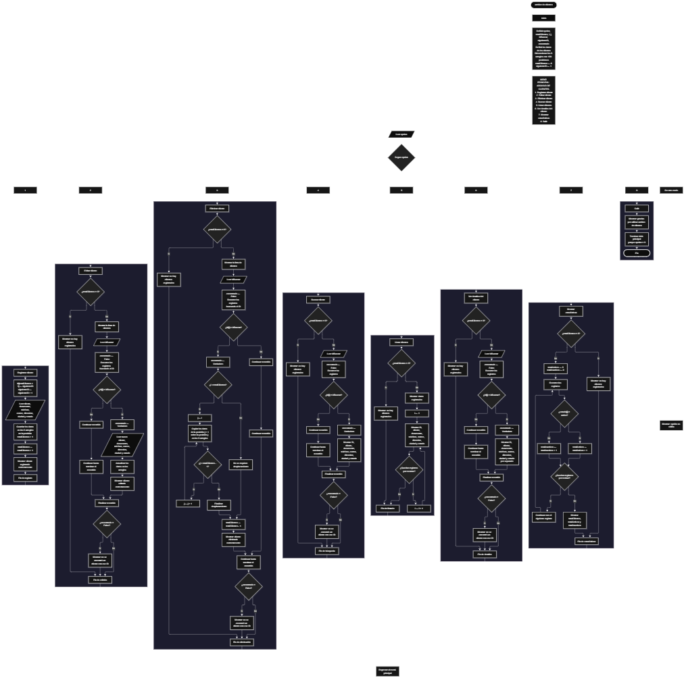

 

Este proyecto, llamado <b>archivo de clientes</b>, fue desarrollado en <b>pseint</b> como un ejercicio práctico para fortalecer la lógica de programación mediante la creación de un sistema de gestión de clientes desde la consola. El programa cuenta con un menú principal de ocho opciones que permite <b>registrar, editar, eliminar, buscar, listar y consultar la información completa</b> de los clientes registrados, además de mostrar estadísticas generales sobre su estado. Cada cliente almacena datos como el nombre, el documento, el teléfono, el correo electrónico, la dirección, la ciudad y el estado, utilizando arreglos con una capacidad declarada de <b>100 posiciones durante la ejecución</b>. Cada registro recibe un identificador único consecutivo mediante la variable <b>siguienteID</b>. Durante su desarrollo se aplicaron conceptos fundamentales de programación, como variables, arreglos paralelos, estructuras condicionales, ciclos repetitivos y estructuras de selección, además de procesos para buscar, modificar, eliminar y organizar registros. Este proyecto permite poner en práctica los conocimientos adquiridos en PSeInt y sirve como base para desarrollar sistemas de gestión más avanzados utilizando otros lenguajes y tecnologías.

<h2 align="center">⚙️ Funcionamiento del menú principal</h2>

### ➕ Registrar cliente

La opción <b>1) registrar cliente</b> permite incorporar un nuevo cliente al sistema. Al comenzar el registro, el programa asigna un identificador mediante la variable <b>siguienteID</b>, almacena ese valor en el arreglo <b>id</b> y aumenta el identificador para el próximo registro. Después, solicita el <b>nombre, documento, teléfono, correo electrónico, dirección, ciudad y estado</b> del cliente. Cada dato se guarda en la posición correspondiente de su respectivo arreglo, utilizando como índice la expresión <b>totalClientes + 1</b>. Una vez ingresada toda la información, la variable <b>totalClientes</b> aumenta en uno y el programa muestra el mensaje <b>"cliente registrado correctamente."</b>. El código declara una capacidad de 100 posiciones para cada arreglo, pero no comprueba si todavía existe espacio disponible antes de registrar un nuevo cliente.

### ✏️ Editar cliente

La opción <b>2) editar cliente</b> permite modificar la información de un cliente registrado. Primero, el programa comprueba si la variable <b>totalClientes</b> es igual a cero. Si no existen registros, muestra el mensaje <b>"no hay clientes registrados."</b>. En caso contrario, presenta una lista con los datos almacenados de los clientes, incluyendo su identificador, nombre, documento, teléfono, correo electrónico, dirección, ciudad y estado. Después, solicita el identificador del cliente que se desea editar y almacena el valor introducido en la variable <b>idBuscar</b>. A continuación, inicializa la variable lógica <b>encontrado</b> con el valor <b>falso</b> y recorre los registros mediante un ciclo <b>para</b>. Cuando encuentra una coincidencia entre <b>id[i]</b> e <b>idBuscar</b>, cambia <b>encontrado</b> a <b>verdadero</b> y solicita los nuevos datos del cliente, actualizando directamente los valores de los arreglos correspondientes. Finalmente, muestra el mensaje <b>"cliente editado correctamente."</b>. Si el identificador no corresponde a ningún cliente registrado, presenta el mensaje <b>"no se encontró un cliente con ese id."</b>.

### 🗑️ Eliminar cliente

La opción <b>3) eliminar cliente</b> permite eliminar un registro mediante el identificador del cliente. Antes de comenzar, el programa comprueba si existen clientes almacenados. Si la variable <b>totalClientes</b> es igual a cero, muestra el mensaje <b>"no hay clientes registrados."</b>. Si existen registros, presenta una lista con la información de los clientes y solicita el identificador que se desea eliminar. Después, inicializa la variable <b>encontrado</b> con el valor <b>falso</b> y recorre los arreglos para localizar el identificador solicitado. Cuando encuentra una coincidencia, cambia la variable a <b>verdadero</b>. Si el registro no ocupa la última posición, utiliza un ciclo <b>para</b> controlado por la variable <b>j</b> para desplazar una posición hacia atrás los datos de los registros posteriores en los ocho arreglos: <b>id, cliente, documento, telefono, correo, direccion, ciudad y estado</b>. A continuación, disminuye la variable <b>totalClientes</b> en uno y muestra el mensaje <b>"cliente eliminado correctamente."</b>. El código no limpia expresamente la última posición después del desplazamiento, aunque esa posición deja de formar parte de los registros activos porque el contador disminuye. Si el identificador no existe, muestra el mensaje <b>"no se encontró un cliente con ese id."</b>.

### 🔎 Buscar cliente

La opción <b>4) buscar cliente</b> permite localizar un registro mediante su identificador. Primero, el programa comprueba si existen clientes registrados. Si no hay registros, muestra el mensaje <b>"no hay clientes registrados."</b>. En caso contrario, solicita el identificador del cliente y lo almacena en la variable <b>idBuscar</b>. Después, inicializa <b>encontrado</b> con el valor <b>falso</b> y utiliza un ciclo <b>para</b> para recorrer los identificadores almacenados. Cuando encuentra una coincidencia mediante la condición <b>id[i] = idBuscar</b>, cambia la variable a <b>verdadero</b>, muestra el mensaje <b>"datos encontrados"</b> y presenta el identificador, nombre, documento, teléfono, correo electrónico, dirección, ciudad y estado del cliente. Si termina el recorrido sin encontrar una coincidencia, muestra el mensaje <b>"no se encontró un cliente con ese id."</b>. Esta búsqueda permite consultar los datos de un cliente sin necesidad de recorrer manualmente la lista completa.

### 📋 Listar clientes

La opción <b>5) listar clientes</b> permite visualizar todos los clientes registrados en el sistema. Antes de mostrar la información, el programa comprueba si la variable <b>totalClientes</b> es igual a cero. Si no existen registros, presenta el mensaje <b>"no hay clientes registrados."</b>. Si hay clientes disponibles, muestra el encabezado <b>"datos registrados"</b> y utiliza un ciclo <b>para</b> para recorrer los arreglos desde la primera posición hasta el total de registros activos. En cada repetición, presenta el identificador, nombre, documento, teléfono, correo electrónico, dirección, ciudad y estado del cliente. Esta función facilita la consulta general de los registros almacenados sin tener que buscar cada cliente individualmente.

### 📄 Ver detalles del cliente

La opción <b>6) ver detalles del cliente</b> permite consultar de manera individual toda la información de un cliente específico. Primero, el programa verifica si existen registros mediante la variable <b>totalClientes</b>. Si no hay clientes registrados, muestra el mensaje <b>"no hay clientes registrados."</b>. En caso contrario, solicita el identificador del cliente y almacena el valor introducido en <b>idBuscar</b>. A continuación, inicializa la variable <b>encontrado</b> con el valor <b>falso</b> y recorre los registros mediante un ciclo <b>para</b>. Cuando encuentra el identificador solicitado, cambia la variable a <b>verdadero</b>, muestra el encabezado <b>"detalles del cliente"</b> y presenta cada dato por separado: identificador, nombre, documento, teléfono, correo electrónico, dirección, ciudad y estado. Si no encuentra el cliente después de recorrer los registros, muestra el mensaje <b>"no se encontró un cliente con ese id."</b>. Esta opción facilita consultar la información completa de una persona de manera organizada.

### 📊 Mostrar estadísticas

La opción <b>7) mostrar estadísticas</b> permite obtener un resumen general de los clientes registrados y clasificarlos según su estado. Primero, el programa comprueba si la variable <b>totalClientes</b> es igual a cero. Si no hay registros, muestra el mensaje <b>"no hay clientes registrados."</b>. Si existen clientes, inicializa las variables <b>totalActivos</b> y <b>totalInactivos</b> con el valor cero. Después, utiliza un ciclo <b>para</b> para recorrer todos los registros activos y comprueba si el valor de <b>estado[i]</b> es exactamente igual a <b>"activo"</b>. Si la condición se cumple, aumenta <b>totalActivos</b> en uno; de lo contrario, incrementa <b>totalInactivos</b>. Al finalizar el recorrido, muestra el encabezado <b>"estadística general"</b>, el total de clientes registrados, la cantidad de clientes activos y la cantidad de clientes inactivos. Esta clasificación considera como inactivo cualquier registro cuyo estado no coincida exactamente con la palabra <b>"activo"</b>.

### 🚪 Salir del menú principal

La opción <b>8) salir</b> permite finalizar el ciclo del menú principal y muestra el mensaje <b>"gracias por utilizar archivo de clientes."</b>. El menú se encuentra dentro de una estructura repetitiva <b>repetir ... hasta que</b>, que mantiene el programa en funcionamiento mientras el usuario realiza las operaciones disponibles. En este caso, la condición final es <b>hasta que opcion = 8</b>, por lo que la opción de salida coincide correctamente con el valor utilizado para terminar la repetición. De esta manera, después de seleccionar la opción 8, el programa muestra el mensaje de despedida y finaliza la ejecución del algoritmo.

<h2 align="center">🧠 Temas aplicados en el proyecto</h2>

### 📦 Variables

En este proyecto se utilizan variables para controlar la opción seleccionada en el menú, administrar la cantidad de clientes registrados, generar identificadores, recorrer los arreglos, localizar registros y determinar si se encontró un cliente. También se utilizan variables para almacenar los contadores de las estadísticas. Cada variable cumple una función específica dentro de las operaciones de gestión de clientes.

🔢 <b>opcion:</b> Almacena la opción seleccionada por el usuario en el menú principal.

📊 <b>totalClientes:</b> Controla la cantidad actual de clientes registrados y determina cuántas posiciones de los arreglos deben recorrerse.

🔄 <b>i:</b> Funciona como contador en los ciclos <b>para</b> y permite acceder a las posiciones de los arreglos durante las operaciones de búsqueda, edición, eliminación, listado y estadísticas.

🔁 <b>j:</b> Controla el recorrido utilizado para desplazar los datos de los clientes posteriores cuando se elimina un registro.

🆔 <b>idBuscar:</b> Almacena el identificador introducido por el usuario para localizar el cliente que desea buscar, editar, eliminar o consultar.

🔢 <b>siguienteID:</b> Genera identificadores consecutivos para los nuevos clientes. Se incrementa después de asignar cada identificador y no disminuye cuando se elimina un registro.

✅ <b>encontrado:</b> Variable lógica que indica si se ha localizado un cliente con el identificador solicitado.

📈 <b>totalActivos:</b> Cuenta los registros cuyo estado es exactamente igual a <b>"activo"</b> durante el cálculo de las estadísticas.

📉 <b>totalInactivos:</b> Cuenta los registros cuyo estado es diferente de <b>"activo"</b> durante el cálculo de las estadísticas.

### 🗃️ Arreglos

En este proyecto se utilizan ocho arreglos paralelos, cada uno con una capacidad declarada de <b>100 posiciones</b>. Todos comparten el mismo índice para representar la información correspondiente a un mismo cliente. Por ejemplo, los datos almacenados en la primera posición se encuentran distribuidos entre <b>id[1], cliente[1], documento[1], telefono[1], correo[1], direccion[1], ciudad[1] y estado[1]</b>. Esta organización permite recorrer, buscar, modificar, mostrar y eliminar los registros de manera coordinada. La cantidad de registros activos se controla mediante la variable <b>totalClientes</b>.

🆔 <b>id[100]:</b> Almacena los identificadores numéricos asignados a los clientes.

👤 <b>cliente[100]:</b> Almacena los nombres de los clientes registrados.

🪪 <b>documento[100]:</b> Almacena los números de documento de los clientes.

📞 <b>telefono[100]:</b> Almacena los números telefónicos de los clientes.

📧 <b>correo[100]:</b> Almacena las direcciones de correo electrónico de los clientes.

🏠 <b>direccion[100]:</b> Almacena las direcciones de los clientes.

🌆 <b>ciudad[100]:</b> Almacena las ciudades asociadas a los clientes.

📌 <b>estado[100]:</b> Almacena el estado de cada cliente, utilizado posteriormente para calcular las estadísticas.

### 🔀 Estructuras condicionales

En este proyecto se utilizan las estructuras <b>si</b> y <b>sino</b> para comprobar si existen clientes registrados antes de realizar determinadas operaciones, identificar coincidencias entre los identificadores almacenados y el valor solicitado, determinar si un cliente fue encontrado y decidir cómo contabilizar su estado en las estadísticas. También se utiliza una condición para comprobar si el registro eliminado se encuentra antes de la última posición ocupada, lo que permite determinar si es necesario desplazar los datos de los registros posteriores. Estas condiciones permiten que el programa ejecute diferentes instrucciones según la situación de los registros.

### 🔄 Estructuras repetitivas

En este proyecto se utilizan los ciclos <b>para</b> y <b>repetir ... hasta que</b>. Los ciclos <b>para</b> permiten recorrer los arreglos para mostrar los registros, buscar un identificador, editar los datos de un cliente y calcular las estadísticas. Durante la eliminación, también se utilizan para desplazar los datos de los registros posteriores una posición hacia atrás. Por otro lado, el ciclo <b>repetir ... hasta que</b> mantiene activo el menú principal y permite ejecutar diferentes operaciones hasta que el usuario selecciona la opción de salida, identificada con el número <b>8</b>.

### 🎯 Estructura según

El programa utiliza la estructura <b>segun</b> para evaluar el valor almacenado en la variable <b>opcion</b> y ejecutar el bloque de instrucciones correspondiente. Cada caso representa una operación específica del sistema: registrar, editar, eliminar, buscar, listar, ver detalles, mostrar estadísticas o salir. También se utiliza el bloque <b>de otro modo</b> para mostrar el mensaje <b>"opcion no valida."</b> cuando el usuario introduce un valor que no coincide con ninguna de las ocho opciones disponibles. Esta estructura permite organizar las operaciones en secciones diferenciadas dentro del menú principal.

### 🔢 Dimensionamiento de arreglos

El programa utiliza la instrucción <b>dimension</b> para establecer una capacidad declarada de <b>100 posiciones</b> en cada uno de los ocho arreglos. Esta organización permite almacenar los diferentes datos de los clientes utilizando posiciones relacionadas entre sí. La cantidad de registros activos se controla mediante la variable <b>totalClientes</b>, que aumenta cuando se registra un cliente y disminuye cuando se elimina. Sin embargo, el código actual no comprueba si se ha alcanzado la capacidad de los arreglos antes de registrar un nuevo cliente.

### 🔄 Reorganización de registros

Cuando se elimina un cliente, el programa comprueba si su posición es menor que <b>totalClientes</b>. Si existen registros posteriores, utiliza el ciclo <b>para</b> controlado por la variable <b>j</b> para copiar los datos de cada posición siguiente sobre la posición actual. Este desplazamiento se realiza de forma coordinada en los ocho arreglos: <b>id, cliente, documento, telefono, correo, direccion, ciudad y estado</b>. Después, disminuye <b>totalClientes</b> en uno. Aunque no limpia expresamente la última posición, esta deja de formar parte de los registros activos al reducirse el contador. El identificador del siguiente cliente no se reutiliza porque la variable <b>siguienteID</b> conserva su valor y continúa aumentando.

<h2 align="center">¿Cómo se implementaron las operaciones crud en el proyecto?</h2>

Las operaciones <b>crud</b> se implementaron mediante las opciones del menú principal para administrar la información de los clientes. La operación <b>crear</b> corresponde a <b>registrar cliente</b>, donde se asigna un identificador y se almacenan los datos de una nueva persona; <b>leer</b> se realiza mediante las opciones <b>buscar cliente, listar clientes y ver detalles del cliente</b>, que permiten consultar los registros existentes; <b>actualizar</b> corresponde a <b>editar cliente</b>, donde se modifican los datos asociados a un identificador; y <b>eliminar</b> se realiza mediante la opción <b>eliminar cliente</b>, que desplaza los registros posteriores y disminuye el contador de clientes. Estas operaciones utilizan variables, arreglos, estructuras condicionales y ciclos para administrar la información almacenada temporalmente durante la ejecución del programa.

<h2 align="center">Diagrama de flujo del proyecto</h2>

<h2 align="center">🛡️ Validaciones del programa</h2>

### 📭 No existen clientes registrados

Esta comprobación se utiliza en las opciones de <b>editar, eliminar, buscar, listar, ver detalles y mostrar estadísticas</b>. El programa verifica si la variable <b>totalClientes</b> es igual a <b>0</b>. Si no existen registros, muestra el mensaje <b>"no hay clientes registrados."</b> y evita ejecutar las operaciones que necesitan información almacenada. Esta comprobación permite manejar el caso en que el usuario intenta consultar o administrar clientes cuando todavía no ha registrado ninguno.

### ⚠️ Capacidad de los arreglos

Los arreglos del programa tienen una capacidad declarada de <b>100 posiciones</b>. Sin embargo, en la opción de registro no existe una condición que compruebe si <b>totalClientes</b> es menor que <b>100</b> antes de almacenar un nuevo cliente. Por esta razón, el código no implementa una validación que impida registrar más clientes de los que permiten los arreglos. Para evitar acceder a posiciones fuera del rango declarado, sería necesario incorporar una comprobación de capacidad antes de realizar el registro.

### ❌ Cliente no encontrado

Esta comprobación se utiliza durante las operaciones de <b>editar, eliminar, buscar y ver detalles del cliente</b>. El programa inicializa la variable lógica <b>encontrado</b> con el valor <b>falso</b> y recorre los identificadores almacenados para compararlos con el valor introducido en <b>idBuscar</b>. Cuando encuentra una coincidencia, cambia la variable a <b>verdadero</b> y ejecuta las instrucciones correspondientes a la operación. Si finaliza el recorrido y la variable continúa siendo <b>falso</b>, muestra el mensaje <b>"no se encontró un cliente con ese id."</b>. De esta manera, el programa informa cuando el identificador solicitado no corresponde a ningún registro activo.

### 📌 Clasificación del estado del cliente

Esta comprobación se realiza en la opción <b>mostrar estadísticas</b>. El programa compara el valor de <b>estado[i]</b> con el texto <b>"activo"</b>. Si ambos valores coinciden exactamente, aumenta el contador <b>totalActivos</b>; de lo contrario, aumenta <b>totalInactivos</b>. El código no comprueba que el estado introducido sea exclusivamente <b>"activo"</b> o <b>"inactivo"</b>, ni convierte el texto a minúsculas antes de compararlo. Por esta razón, valores como <b>"Activo"</b>, <b>"INACTIVO"</b> o cualquier otro texto diferente de <b>"activo"</b> se contabilizan como inactivos.

### 🔢 Opción inválida

La estructura <b>segun</b> incluye el bloque <b>de otro modo</b>, que muestra el mensaje <b>"opcion no valida."</b> cuando el usuario introduce un valor que no coincide con las opciones del menú principal. Las opciones disponibles están comprendidas entre <b>1</b> y <b>8</b>, por lo que los demás valores no ejecutan ninguna de las operaciones definidas. El código no incluye comprobaciones adicionales para restringir la entrada a números enteros dentro del rango permitido antes de evaluar la opción.

### 🔐 Identificadores consecutivos

El programa utiliza la variable <b>siguienteID</b> para asignar un identificador nuevo cada vez que se registra un cliente. Después de asignarlo, incrementa la variable en uno. Cuando se elimina un cliente, el identificador no se reutiliza, aunque sus datos dejen de formar parte de los registros activos. Esta organización permite conservar la secuencia de identificadores durante la ejecución, independientemente de los desplazamientos que se realizan al eliminar registros.

<h2 align="center">🎯 Objetivo del proyecto</h2>

El objetivo principal de este proyecto es fortalecer la <b>lógica de programación</b> mediante el desarrollo de un sistema de gestión de clientes en <b>pseint</b>. A través de su construcción se busca aplicar los conocimientos adquiridos sobre variables, arreglos paralelos, estructuras condicionales, ciclos repetitivos y estructuras de selección, integrándolos para resolver un problema de manera organizada. Además, el proyecto permite comprender cómo registrar, consultar, modificar, eliminar y clasificar información mediante estadísticas básicas en una aplicación de consola. De esta manera, se establece una base para desarrollar sistemas de gestión más completos utilizando otros lenguajes de programación y tecnologías.

